# Poke-README

[**🇧🇷 Português**](#pt) | [**🇺🇸 English**](#en) | [**🇪🇸 Español**](#es)

---

<a id="pt"></a>

## 🇧🇷 Português

<div align="center">
  
  <h1>Poke-README</h1>
  <p><strong>Um time Pokémon animado no seu perfil do GitHub que evolui com as suas contribuições reais.</strong></p>

  <p>
    <a href="https://pokereadme.murilonoguez.com.br/"><strong>🚀 Abrir o Poke-README Builder 🚀</strong></a>
  </p>

  <p>
    <strong>Português</strong> •
    <a href="#en">English</a> •
    <a href="#es">Español</a>
  </p>

  <p align="center">
    
  </p>
</div>

---

## 🌟 Demonstração ao Vivo

<div align="center">
  
  <br/>
  <sub><i>O time é calculado a cada atualização: quanto mais você contribui, mais ele evolui.</i></sub>
</div>

---

## ⚡ Início Rápido

O jeito mais fácil é usar o **[Builder](https://pokereadme.murilonoguez.com.br/)**: digite seu usuário do GitHub, escolha até 6 Pokémon, veja a prévia ao vivo e copie o código pronto.

Se preferir montar na mão, cole isto no README do seu perfil:

```html
<div align="center">
  
</div>
```

---

## 🧩 Parâmetros

| Parâmetro | Obrigatório | Descrição                                                                                     | Exemplo              |
| --------- | ----------- | --------------------------------------------------------------------------------------------- | -------------------- |
| `user`    | ✅          | Seu usuário do GitHub.                                                                        | `user=MuriloNoguez`  |
| `pokes`   | ✅          | Até 6 IDs da Pokédex nacional, separados por vírgula.                                         | `pokes=1,4,7,25`     |
| `names`   |             | Apelidos na mesma ordem dos Pokémon (máx. 10 caracteres cada).                                | `names=Bulba,,Squirt` |
| `item`    |             | Pedra de evolução do Eevee: `water`, `thunder`, `fire`, `sun`, `moon`, `leaf`, `ice`.         | `item=fire`          |
| `bg`      |             | Fundo do card: `classic` (padrão), `none`, `sunset`, `night`, `snow`, `desert`, `beach`, `autumn`, `sakura`, `rain`, `volcano`, `space`. | `bg=night`           |

Exemplo completo:

```
https://pokereadme.murilonoguez.com.br/api?user=SeuUsuario&pokes=1,4,7&names=Bulba,Char,Squirt&bg=sunset
```

---

## 🚀 Como Funciona

### 📈 Evolução Progressiva

Pediu um **Charizard** (ID 6) mas ainda tem poucas contribuições? O card mostra um **Charmander** e ele evolui sozinho quando você atinge o limite de cada estágio.

- **Travar um estágio:** escolha a forma intermediária (ex: Charmeleon, ID 5) e o Pokémon para nela, mesmo que você tenha contribuições de sobra.
- **Nível do time:** 1 nível a cada 10 contribuições, até o nível 100.

### ✨ A Caçada Shiny (1/8192)

- **Raridade permanente:** o status shiny é calculado a partir do seu ID do GitHub, do Pokémon e da posição no time. Uma vez encontrado, é seu para sempre.
- **Mais chances:** a cada 10 contribuições você ganha uma nova tentativa para cada Pokémon.

### 🔱 Requisitos Lendários

- **A barreira das 1.000 contribuições:** Lendários (como Mewtwo ou Rayquaza) só aparecem a partir de **1.000 contribuições**.
- **Disfarce:** abaixo disso, eles aparecem como um **Ditto**.

### 🔢 Como as Contribuições São Contadas

O total é **de todos os anos**, não só do último.

- **Com `GITHUB_TOKEN`:** soma os commits de cada ano via GraphQL, incluindo contribuições privadas visíveis.
- **Sem token:** lê o calendário público de contribuições (commits, PRs, issues e reviews). Para incluir as privadas, ative **"Private contributions"** no seu perfil.
- **Cache:** o card fica em cache por até 24h na CDN, então evoluções podem demorar um pouco para aparecer.

### 🎨 Sprites e Fundos

- **980 Pokémon (Gen 1 a 9)** com sprites animados do PMD SpriteCollab, andando pelo card. O tamanho de cada um segue a altura real do Pokémon.
- **11 fundos animados:** o clássico e 10 variações temáticas, ou `bg=none` para um fundo sólido.

---

## 🖼️ Galeria & Exemplos

### 🔱 O Conselho Lendário

Requer **1.000+ contribuições**. Antes disso, todos aparecem como Dittos.

```html
<div align="center">
  
</div>
```

<div align="center"></div>

### 💎 Evoluções do Eevee

Escolha a evolução do Eevee com o parâmetro `&item=`.

```html
<div align="center">
  
</div>
```

<div align="center"></div>

### 🌈 Caçadores de Shiny

O flex supremo: chance base de 1/8192, com uma nova tentativa a cada 10 contribuições.

```html
<div align="center">
  
</div>
```

<div align="center"></div>

### 🟢 Time Kanto Padrão

Os iniciais originais, Pikachu, Eevee e o misterioso Ditto.

```html
<div align="center">
  
</div>
```

<div align="center"></div>

---

## ⚙️ Deploy Próprio (Opcional)

A instância pública funciona para todo mundo, mas você pode hospedar a sua para ter mais estabilidade.

### 1. Faça um Fork

Clique em **Fork** no topo deste repositório.

### 2. Gere um Token do GitHub

O token permite contar commits via GraphQL e evita o limite de requisições sem autenticação.

- Vá em **Settings > Developer settings > Personal access tokens > Tokens (classic)**.
- Gere um token com a permissão `read:user` e copie.

### 3. Deploy na Vercel

- Crie uma conta na [Vercel](https://vercel.com/) e importe o seu fork.
- Em **Environment Variables**, adicione `GITHUB_TOKEN` com o token gerado.
- Clique em **Deploy**.

### 4. Use no seu Perfil

Troque `https://pokereadme.murilonoguez.com.br` pela URL que a Vercel te deu (ex: `meu-poke-readme.vercel.app`).

### 🧪 Rodando Localmente

```bash
npm install
cp .env.example .env   # opcional: coloque seu GITHUB_TOKEN
npm run dev            # http://localhost:3000
```

Quer contribuir? Veja o [CONTRIBUTING.md](CONTRIBUTING.md).

---

<div align="center">
  <p>Feito por <b><a href="https://github.com/MuriloNoguez">Murilo Noguêz</a></b></p>
  <p>Para os saudosistas da era clássica do Game Boy!</p>
  <br/>
  <p><i><b>Aviso Legal:</b> Pokemon e todos os nomes e sprites associados são marcas registradas e pertencem à Nintendo, Creatures Inc. e GAME FREAK inc. Este é um projeto não-oficial feito de fã para fãs, sem fins lucrativos. A licença de código aberto se aplica apenas à base de código (programação), e não aos ativos da marca.</i></p>
  <p><i><b>Créditos:</b> sprites animados do <a href="https://github.com/PMDCollab/SpriteCollab">PMD SpriteCollab</a> (CC BY-NC 4.0, uso não comercial) e dados da <a href="https://pokeapi.co/">PokéAPI</a>. Lista completa de artistas por Pokémon em <a href="CREDITS.md">CREDITS.md</a>.</i></p>
</div>

---

<a id="en"></a>

## 🇺🇸 English

<div align="center">
  
  <h1>Poke-README</h1>
  <p><strong>An animated Pokémon team for your GitHub profile that evolves with your real contributions.</strong></p>

  <p>
    <a href="https://pokereadme.murilonoguez.com.br/"><strong>🚀 Open the Poke-README Builder 🚀</strong></a>
  </p>

  <p>
    <a href="#pt">Português</a> •
    <strong>English</strong> •
    <a href="#es">Español</a>
  </p>

  <p align="center">
    
  </p>
</div>

---

## 🌟 Live Demo

<div align="center">
  
  <br/>
  <sub><i>The team is recalculated on every refresh: the more you contribute, the more it evolves.</i></sub>
</div>

---

## ⚡ Quick Start

The easiest way is the **[Builder](https://pokereadme.murilonoguez.com.br/)**: type your GitHub username, pick up to 6 Pokémon, check the live preview and copy the ready-made code.

If you prefer to write it by hand, paste this into your profile README:

```html
<div align="center">
  
</div>
```

---

## 🧩 Parameters

| Parameter | Required | Description                                                                                   | Example               |
| --------- | -------- | --------------------------------------------------------------------------------------------- | --------------------- |
| `user`    | ✅       | Your GitHub username.                                                                         | `user=MuriloNoguez`   |
| `pokes`   | ✅       | Up to 6 National Pokédex IDs, comma-separated.                                                | `pokes=1,4,7,25`      |
| `names`   |          | Nicknames in the same order as the Pokémon (max 10 characters each).                          | `names=Bulba,,Squirt` |
| `item`    |          | Eevee evolution stone: `water`, `thunder`, `fire`, `sun`, `moon`, `leaf`, `ice`.              | `item=fire`           |
| `bg`      |          | Card background: `classic` (default), `none`, `sunset`, `night`, `snow`, `desert`, `beach`, `autumn`, `sakura`, `rain`, `volcano`, `space`. | `bg=night`            |

Full example:

```
https://pokereadme.murilonoguez.com.br/api?user=YourUsername&pokes=1,4,7&names=Bulba,Char,Squirt&bg=sunset
```

---

## 🚀 How It Works

### 📈 Progressive Evolution

Asked for a **Charizard** (ID 6) but only have a few contributions? The card shows a **Charmander**, and it evolves on its own as you reach each stage's threshold.

- **Lock a stage:** pick the middle form (e.g. Charmeleon, ID 5) and the Pokémon stops there, even if you have contributions to spare.
- **Team level:** 1 level per 10 contributions, up to level 100.

### ✨ The 1/8192 Shiny Hunt

- **Permanent rarity:** shiny status is derived from your GitHub user ID, the Pokémon and its team slot. Once found, it's yours forever.
- **More chances:** every 10 contributions give you a new roll for each Pokémon.

### 🔱 Legendary Requirements

- **The 1,000 contribution barrier:** Legendaries (like Mewtwo or Rayquaza) only show up from **1,000 contributions** on.
- **Disguise:** below that, they appear as a **Ditto**.

### 🔢 How Contributions Are Counted

The total covers **every year**, not just the last one.

- **With `GITHUB_TOKEN`:** sums each year's commits through GraphQL, including visible private contributions.
- **Without a token:** reads the public contribution calendar (commits, PRs, issues and reviews). To include private ones, enable **"Private contributions"** on your profile.
- **Cache:** the card is cached for up to 24h on the CDN, so evolutions may take a while to show up.

### 🎨 Sprites & Backgrounds

- **980 Pokémon (Gen 1 to 9)** with animated PMD SpriteCollab sprites walking across the card. Each one is sized by the Pokémon's real height.
- **11 animated backgrounds:** the classic one plus 10 themed variants, or `bg=none` for a solid background.

---

## 🖼️ Gallery & Examples

### 🔱 The Legendary Council

Requires **1,000+ contributions**. Until then, they all show up as Dittos.

```html
<div align="center">
  
</div>
```

<div align="center"></div>

### 💎 Eevee Branching Evolutions

Pick Eevee's evolution with the `&item=` parameter.

```html
<div align="center">
  
</div>
```

<div align="center"></div>

### 🌈 Shiny Hunters

The ultimate flex: a 1/8192 base chance, with a new roll every 10 contributions.

```html
<div align="center">
  
</div>
```

<div align="center"></div>

### 🟢 Standard Kanto Team

The original starters, Pikachu, Eevee and the mysterious Ditto.

```html
<div align="center">
  
</div>
```

<div align="center"></div>

---

## ⚙️ Self-Hosting (Optional)

The public instance works for everyone, but you can host your own for extra stability.

### 1. Fork the Repo

Click **Fork** at the top of this repository.

### 2. Generate a GitHub Token

The token enables commit counting through GraphQL and avoids the unauthenticated rate limit.

- Go to **Settings > Developer settings > Personal access tokens > Tokens (classic)**.
- Generate a token with the `read:user` scope and copy it.

### 3. Deploy to Vercel

- Create a [Vercel](https://vercel.com/) account and import your fork.
- Under **Environment Variables**, add `GITHUB_TOKEN` with your token.
- Click **Deploy**.

### 4. Use It on Your Profile

Replace `https://pokereadme.murilonoguez.com.br` with the URL Vercel gave you (e.g. `my-poke-readme.vercel.app`).

### 🧪 Running Locally

```bash
npm install
cp .env.example .env   # optional: add your GITHUB_TOKEN
npm run dev            # http://localhost:3000
```

Want to contribute? See [CONTRIBUTING.md](CONTRIBUTING.md).

---

<div align="center">
  <p>Made by <b><a href="https://github.com/MuriloNoguez">Murilo Noguêz</a></b></p>
  <p>For those who miss the classic Game Boy era!</p>
  <br/>
  <p><i><b>Legal Notice:</b> Pokemon and all associated names and sprites are trademarks of Nintendo, Creatures Inc. and GAME FREAK inc. This is a non-profit fan project. The open-source license applies only to the codebase, not the brand assets.</i></p>
  <p><i><b>Credits:</b> animated sprites from <a href="https://github.com/PMDCollab/SpriteCollab">PMD SpriteCollab</a> (CC BY-NC 4.0, non-commercial) and data from <a href="https://pokeapi.co/">PokéAPI</a>. Full per-Pokémon artist list in <a href="CREDITS.md">CREDITS.md</a>.</i></p>
</div>

---

<a id="es"></a>

## 🇪🇸 Español

<div align="center">
  
  <h1>Poke-README</h1>
  <p><strong>Un equipo Pokémon animado para tu perfil de GitHub que evoluciona con tus contribuciones reales.</strong></p>

  <p>
    <a href="https://pokereadme.murilonoguez.com.br/"><strong>🚀 Abrir el Poke-README Builder 🚀</strong></a>
  </p>

  <p>
    <a href="#pt">Português</a> •
    <a href="#en">English</a> •
    <strong>Español</strong>
  </p>

  <p align="center">
    
  </p>
</div>

---

## 🌟 Demostración en Vivo

<div align="center">
  
  <br/>
  <sub><i>El equipo se recalcula en cada actualización: cuanto más contribuyes, más evoluciona.</i></sub>
</div>

---

## ⚡ Inicio Rápido

La forma más fácil es usar el **[Builder](https://pokereadme.murilonoguez.com.br/)**: escribe tu usuario de GitHub, elige hasta 6 Pokémon, mira la vista previa en vivo y copia el código listo.

Si prefieres armarlo a mano, pega esto en el README de tu perfil:

```html
<div align="center">
  
</div>
```

---

## 🧩 Parámetros

| Parámetro | Obligatorio | Descripción                                                                                   | Ejemplo               |
| --------- | ----------- | --------------------------------------------------------------------------------------------- | --------------------- |
| `user`    | ✅          | Tu usuario de GitHub.                                                                         | `user=MuriloNoguez`   |
| `pokes`   | ✅          | Hasta 6 IDs de la Pokédex nacional, separados por comas.                                      | `pokes=1,4,7,25`      |
| `names`   |             | Apodos en el mismo orden que los Pokémon (máx. 10 caracteres cada uno).                       | `names=Bulba,,Squirt` |
| `item`    |             | Piedra evolutiva de Eevee: `water`, `thunder`, `fire`, `sun`, `moon`, `leaf`, `ice`.          | `item=fire`           |
| `bg`      |             | Fondo de la tarjeta: `classic` (por defecto), `none`, `sunset`, `night`, `snow`, `desert`, `beach`, `autumn`, `sakura`, `rain`, `volcano`, `space`. | `bg=night`            |

Ejemplo completo:

```
https://pokereadme.murilonoguez.com.br/api?user=TuUsuario&pokes=1,4,7&names=Bulba,Char,Squirt&bg=sunset
```

---

## 🚀 Cómo Funciona

### 📈 Evolución Progresiva

¿Pediste un **Charizard** (ID 6) pero tienes pocas contribuciones? La tarjeta muestra un **Charmander**, y evoluciona solo cuando alcanzas el límite de cada etapa.

- **Fijar una etapa:** elige la forma intermedia (ej: Charmeleon, ID 5) y el Pokémon se queda ahí, aunque te sobren contribuciones.
- **Nivel del equipo:** 1 nivel cada 10 contribuciones, hasta el nivel 100.

### ✨ Caza Shiny (1/8192)

- **Rareza permanente:** el estado shiny se calcula a partir de tu ID de GitHub, el Pokémon y su posición en el equipo. Una vez encontrado, es tuyo para siempre.
- **Más oportunidades:** cada 10 contribuciones ganas un nuevo intento para cada Pokémon.

### 🔱 Requisitos Legendarios

- **La barrera de las 1.000 contribuciones:** los Legendarios (como Mewtwo o Rayquaza) solo aparecen a partir de **1.000 contribuciones**.
- **Disfraz:** por debajo de eso, aparecen como un **Ditto**.

### 🔢 Cómo se Cuentan las Contribuciones

El total abarca **todos los años**, no solo el último.

- **Con `GITHUB_TOKEN`:** suma los commits de cada año vía GraphQL, incluyendo las contribuciones privadas visibles.
- **Sin token:** lee el calendario público de contribuciones (commits, PRs, issues y reviews). Para incluir las privadas, activa **"Private contributions"** en tu perfil.
- **Caché:** la tarjeta queda en caché hasta 24h en la CDN, así que las evoluciones pueden tardar un poco en aparecer.

### 🎨 Sprites y Fondos

- **980 Pokémon (Gen 1 a 9)** con sprites animados de PMD SpriteCollab caminando por la tarjeta. El tamaño de cada uno sigue la altura real del Pokémon.
- **11 fondos animados:** el clásico y 10 variaciones temáticas, o `bg=none` para un fondo sólido.

---

## 🖼️ Galería y Ejemplos

### 🔱 El Consejo Legendario

Requiere **1.000+ contribuciones**. Antes de eso, todos aparecen como Dittos.

```html
<div align="center">
  
</div>
```

<div align="center"></div>

### 💎 Evoluciones de Eevee

Elige la evolución de Eevee con el parámetro `&item=`.

```html
<div align="center">
  
</div>
```

<div align="center"></div>

### 🌈 Caza Shiny

El flex definitivo: probabilidad base de 1/8192, con un nuevo intento cada 10 contribuciones.

```html
<div align="center">
  
</div>
```

<div align="center"></div>

### 🟢 Equipo Kanto Estándar

Los iniciales originales, Pikachu, Eevee y el misterioso Ditto.

```html
<div align="center">
  
</div>
```

<div align="center"></div>

---

## ⚙️ Despliegue Propio (Opcional)

La instancia pública funciona para todos, pero puedes alojar la tuya para tener más estabilidad.

### 1. Haz un Fork

Haz clic en **Fork** en la parte superior de este repositorio.

### 2. Genera un Token de GitHub

El token permite contar commits vía GraphQL y evita el límite de solicitudes sin autenticación.

- Ve a **Settings > Developer settings > Personal access tokens > Tokens (classic)**.
- Genera un token con el permiso `read:user` y cópialo.

### 3. Despliegue en Vercel

- Crea una cuenta en [Vercel](https://vercel.com/) e importa tu fork.
- En **Environment Variables**, agrega `GITHUB_TOKEN` con tu token.
- Haz clic en **Deploy**.

### 4. Úsalo en tu Perfil

Reemplaza `https://pokereadme.murilonoguez.com.br` por la URL que te dio Vercel (ej: `mi-poke-readme.vercel.app`).

### 🧪 Ejecución Local

```bash
npm install
cp .env.example .env   # opcional: agrega tu GITHUB_TOKEN
npm run dev            # http://localhost:3000
```

¿Quieres contribuir? Mira el [CONTRIBUTING.md](CONTRIBUTING.md).

---

<div align="center">
  <p>Hecho por <b><a href="https://github.com/MuriloNoguez">Murilo Noguêz</a></b></p>
  <p>¡Para los que extrañan la era clásica de Game Boy!</p>
  <br/>
  <p><i><b>Aviso Legal:</b> Pokemon y todos los nombres y sprites asociados son marcas registradas y pertenecen a Nintendo, Creatures Inc. y GAME FREAK inc. Este es un proyecto no-oficial hecho de fans para fans, sin fines de lucro. La licencia de código abierto se aplica solo a la base de código (programación) y no a los activos de la marca.</i></p>
  <p><i><b>Créditos:</b> sprites animados de <a href="https://github.com/PMDCollab/SpriteCollab">PMD SpriteCollab</a> (CC BY-NC 4.0, uso no comercial) y datos de <a href="https://pokeapi.co/">PokéAPI</a>. Lista completa de artistas por Pokémon en <a href="CREDITS.md">CREDITS.md</a>.</i></p>
</div>
